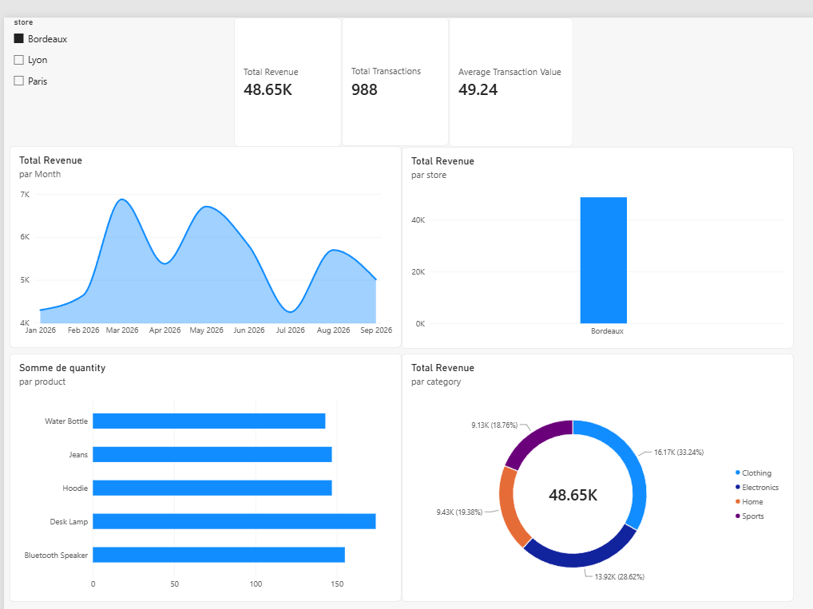

# NovaRetail Analytics
### End-to-End Retail Data Engineering & Business Intelligence

**Python · Pandas · DuckDB · SQL · Power BI · DAX · Data Quality**

An end-to-end retail analytics project demonstrating how transactional data can be generated, validated, cleaned, stored, analyzed and transformed into an interactive business intelligence dashboard.

The project simulates a real-world analytics engagement for **NovaRetail**, a fictional multi-store retailer operating across Paris, Lyon and Bordeaux.

It covers the complete analytical workflow, from raw data ingestion to business-facing reporting, with an emphasis on **data reliability, reproducibility and actionable insights**.

> **Project status:** Functional analytics pipeline and interactive Power BI dashboard completed. Additional automation and production-oriented improvements are planned.

---

## 1. Dashboard Preview



**Reporting period:** January–September 2026

The Power BI dashboard provides an overview of retail performance, including revenue, transaction volume, average transaction value, monthly trends, store comparisons and product performance.

An interactive store slicer allows users to filter the report by location.

**Power BI report:** [`NovaRetail_Sales_Dashboard.pbix`](dashboards/NovaRetail_Sales_Dashboard.pbix)

---

## 2. Business Context

NovaRetail is a fictional retail company selling products across four categories:

- Clothing
- Electronics
- Sports
- Home

The company operates three stores: Paris, Lyon and Bordeaux.

Like many retail businesses, NovaRetail needs reliable information to understand sales performance, monitor trends and identify opportunities for improvement.

However, raw transactional datasets can contain inconsistencies that compromise reporting accuracy.

This project addresses two interconnected challenges:

**Data reliability:** How can transaction data be systematically validated and cleaned before being used for business reporting?

**Business visibility:** How can validated transaction data be transformed into meaningful KPIs and interactive visualizations?

### Key Business Questions

1. How much revenue has NovaRetail generated?
2. Which stores contribute the most revenue?
3. Which products sell the highest quantities?
4. How does revenue evolve month over month?
5. What is the average transaction value?
6. Which product categories generate the most revenue?
7. How do customers distribute their transactions across payment methods?
8. How do these metrics change when filtering by store?

---

## 3. Project Objectives

The project was designed around five objectives.

| Objective | Implementation |
|---|---|
| Data ingestion | Generate and load synthetic retail transactions |
| Data quality | Detect duplicates, missing values and invalid business values |
| Analytical storage | Store cleaned data in DuckDB |
| Business analytics | Calculate KPIs using SQL and DAX |
| Data visualization | Build an interactive Power BI dashboard |

The intended deliverable is a reproducible analytics workflow supported by documented business metrics and an accessible reporting interface.

---

## 4. Technology Stack

| Technology | Role |
|---|---|
| Python | Data pipeline orchestration and processing |
| Pandas | Data exploration, cleaning, validation and export |
| NumPy | Synthetic data generation and numerical operations |
| DuckDB | Embedded analytical SQL database |
| SQL | Business queries, aggregations, CTEs and window functions |
| Power BI Desktop | Dashboard development and visualization |
| DAX | Dynamic measures and filter-aware KPI calculations |
| Git / GitHub | Version control and portfolio publication |

### Why DuckDB?

DuckDB is a lightweight analytical database that supports SQL queries directly against structured datasets.

For this project, it provides:

- Local analytical storage without a separate database server
- SQL-based aggregation and analysis
- Integration with Python and Pandas
- Support for common analytical operations, including window functions

DuckDB is suitable for this local portfolio workflow. A production deployment might require a different storage or processing architecture depending on data volume, concurrency and operational requirements.

---

## 5. Architecture and Data Flow

The project follows a staged analytical pipeline.

```text
Synthetic Transaction Generator
              |
              v
       Raw CSV Dataset
              |
              v
    Data Quality Inspection
              |
              v
     Error Injection Stage
              |
              v
       Data Quality Audit
              |
              v
      Cleaning & Validation
           /        \
          v          v
   Clean Dataset   Quarantine Dataset
          |
          v
   Revenue Consistency Check
          |
          v
      DuckDB Database
          |
          v
      SQL Analytics
          |
          v
     Dashboard CSV Exports
          |
          v
      Power BI Reporting
```

The final interactive Power BI dashboard additionally uses the cleaned transaction-level CSV as its primary reporting table.

This allows DAX measures to respond dynamically to user selections rather than relying exclusively on static, pre-aggregated exports.

### Design Principles

**Separation of responsibilities:** Data generation, auditing, cleaning, validation, storage and analysis are handled in distinct scripts.

**Data traceability:** Invalid records are preserved in a quarantine dataset for investigation.

**Metric consistency:** Revenue calculations are checked before analytical reporting.

**Reproducibility:** The pipeline uses local files and documented Python dependencies.

**Business orientation:** Analytical outputs are designed around questions relevant to retail performance.

---

## 6. Dataset Description

### Dataset Overview

The project uses synthetic transactional data generated specifically for this portfolio case study.

| Property | Value |
|---|---|
| Business | NovaRetail (fictional) |
| Data type | Retail transactions |
| Reporting period | January–September 2026 |
| Original transactions | 5,000 |
| Rows after error injection | 5,040 |
| Clean transactions | 4,902 |
| Quarantined transactions | 98 |
| Stores | 3 |
| Product categories | 4 |

### Data Dictionary

| Column | Description |
|---|---|
| `transaction_id` | Unique transaction identifier |
| `transaction_date` | Date of the transaction |
| `product` | Product purchased |
| `category` | Product category |
| `quantity` | Number of units purchased |
| `unit_price` | Price per unit |
| `discount_rate` | Discount expressed as a decimal between 0 and 1 |
| `payment_method` | Payment method used |
| `store` | Store location |
| `revenue` | Transaction revenue after discount |

### Revenue Calculation

Transaction revenue is calculated as:

```text
revenue = quantity × unit_price × (1 - discount_rate)
```

For example, a transaction involving three products at €20 each with a 10% discount generates:

```text
3 × 20 × (1 - 0.10) = €54.00
```

The revenue validation step checks whether stored revenue values are consistent with the underlying transaction attributes, allowing for monetary rounding.

---

## 7. Data Quality and Cleaning

Data quality is a central component of the project.

Rather than analyzing an artificially perfect dataset, controlled anomalies were introduced to simulate common problems encountered in transactional systems.

### Injected Data Quality Issues

| Issue | Injected records | Why it matters |
|---|---:|---|
| Missing unit prices | 50 | Prevents reliable revenue validation |
| Negative quantities | 30 | Violates expected sales quantity rules |
| Invalid discount rates | 20 | Produces inconsistent pricing calculations |
| Duplicate rows | 40 | Can inflate transaction counts and revenue |

The injected anomalies are used to evaluate whether the cleaning workflow detects and handles invalid data.

### Cleaning Strategy

The cleaning process applies the following business rules:

- Remove exact duplicate rows.
- Reject missing or nonpositive unit prices.
- Reject quantities less than or equal to zero.
- Reject discount rates outside the interval `[0, 1]`.
- Preserve rejected records separately for investigation.

Invalid records are not silently imputed because their correct business values cannot be established reliably from the available data.

### Cleaning Results

| Metric | Records |
|---|---:|
| Input rows | 5,040 |
| Exact duplicates removed | 40 |
| Rows after deduplication | 5,000 |
| Valid transactions retained | 4,902 |
| Transactions quarantined | 98 |

The 98 quarantined records represent approximately **1.96%** of the deduplicated dataset.

### Revenue Validation

After cleaning, transaction revenue is recalculated using the original quantity, unit price and discount.

The validation found **zero revenue discrepancies greater than €0.01** across the 4,902 retained records.

This provides an additional consistency check before loading data into the analytical database.

---

## 8. SQL Analytics

Cleaned transactions are loaded into DuckDB and stored in a table named `transactions`.

The analytical layer answers business questions through SQL queries.

### 8.1 Total Revenue

```sql
SELECT
    ROUND(SUM(revenue), 2) AS total_revenue
FROM transactions;
```

**Result:** €241,747.08

### 8.2 Revenue by Store

```sql
SELECT
    store,
    ROUND(SUM(revenue), 2) AS total_revenue
FROM transactions
GROUP BY store
ORDER BY total_revenue DESC;
```

| Store | Revenue |
|---|---:|
| Paris | €120,218.12 |
| Lyon | €72,875.87 |
| Bordeaux | €48,653.09 |

Paris represents approximately 49.73% of total revenue.

### 8.3 Best-Selling Products

```sql
SELECT
    product,
    SUM(quantity) AS total_quantity
FROM transactions
GROUP BY product
ORDER BY total_quantity DESC
LIMIT 5;
```

| Product | Units Sold |
|---|---:|
| Resistance Bands | 774 |
| Bluetooth Speaker | 773 |
| Jeans | 766 |
| Yoga Mat | 726 |
| Hoodie | 711 |

These rankings measure sales volume rather than profitability.

### 8.4 Monthly Revenue

```sql
SELECT
    DATE_TRUNC('month', transaction_date) AS month,
    ROUND(SUM(revenue), 2) AS monthly_revenue
FROM transactions
GROUP BY month
ORDER BY month ASC;
```

Monthly aggregation provides the basis for time-series visualization and trend monitoring.

### 8.5 Month-over-Month Revenue Growth

The project uses a SQL window function to compare revenue against the previous month.

```sql
WITH monthly_sales AS (
    SELECT
        DATE_TRUNC('month', transaction_date) AS month,
        SUM(revenue) AS monthly_revenue
    FROM transactions
    GROUP BY month
),
growth_analysis AS (
    SELECT
        month,
        monthly_revenue,
        LAG(monthly_revenue) OVER (
            ORDER BY month
        ) AS previous_month_revenue
    FROM monthly_sales
)
SELECT
    month,
    ROUND(monthly_revenue, 2) AS monthly_revenue,
    ROUND(
        (monthly_revenue - previous_month_revenue)
        / NULLIF(previous_month_revenue, 0) * 100,
        2
    ) AS growth_percentage
FROM growth_analysis
ORDER BY month;
```

The use of `LAG()` demonstrates SQL window functions for sequential business analysis.

The query assumes consecutive monthly observations. A calendar dimension would be preferable when reporting periods can be missing.

### Additional Analyses

The project also includes:

- Average transaction value
- Average transaction value by store
- Revenue by product category
- Payment method performance
- Transaction share by payment method

---

## 9. Business KPIs

The main dashboard presents three high-level KPIs.

| KPI | Value | Definition |
|---|---:|---|
| Total Revenue | €241,747.08 | Sum of transaction revenue |
| Total Transactions | 4,902 | Number of unique transactions |
| Average Transaction Value | €49.32 | Total revenue divided by transaction count |

These values correspond to the cleaned synthetic dataset without store-level filtering.

### DAX Measures

The interactive Power BI report uses the following measures.

**Total Revenue**

```dax
Total Revenue =
SUM(sales_clean[revenue])
```

**Total Transactions**

```dax
Total Transactions =
DISTINCTCOUNT(sales_clean[transaction_id])
```

**Average Transaction Value**

```dax
Average Transaction Value =
DIVIDE(
    [Total Revenue],
    [Total Transactions]
)
```

Unlike static SQL exports, these measures respond to the current Power BI filter context.

For example, selecting Paris recalculates the metrics using only transactions associated with that store.

---

## 10. Power BI Dashboard

The dashboard provides an interactive overview of retail performance.

### KPI Cards

Display total revenue, transaction volume and average transaction value.

### Monthly Revenue Trend

A line chart tracks revenue from January through September 2026.

The visual helps identify changes in revenue over time and periods that may require further investigation.

### Store Performance

A column chart compares revenue across Paris, Lyon and Bordeaux.

### Top 5 Products

A ranked bar chart identifies the five products with the highest sales volume.

The ranking updates according to the selected store.

### Revenue by Category

A donut chart displays the relative revenue contribution of Clothing, Electronics, Sports and Home.

### Interactive Filtering

A store slicer enables users to filter the dashboard by location.

The interactive visuals use the cleaned transaction-level dataset, supporting consistent cross-filtering and dynamic recalculation.

### Data Modeling Note

The project initially used separate SQL summary exports to create a static dashboard prototype.

The report was subsequently improved by importing `sales_clean.csv` and introducing DAX measures.

This progression demonstrates the transition from static reporting to a filter-aware analytical model.

---

## 11. Key Findings

The following findings are based exclusively on the synthetic dataset.

### Finding 1: Paris Leads Revenue Generation

Paris generated €120,218.12, representing approximately half of total revenue.

This makes Paris the largest revenue contributor in the simulated retail network.

However, revenue alone does not establish operational efficiency or profitability.

### Finding 2: Clothing Is the Leading Revenue Category

Clothing generated the largest share of revenue, approximately 33.72%, followed by Electronics at approximately 28.83%.

Together, these categories contributed more than 60% of sales revenue.

### Finding 3: Resistance Bands Lead Product Sales Volume

Resistance Bands sold 774 units, narrowly exceeding Bluetooth Speakers at 773 units.

The difference illustrates why rankings should be interpreted in the context of the actual quantities.

### Finding 4: Revenue Declined After May

May recorded the highest monthly revenue at €30,494.10.

Revenue subsequently declined in each month from June through September, reaching €24,670.87.

This pattern may justify investigating seasonality, sales volume, pricing or promotional activity in a real business.

### Finding 5: Data Quality Affects Analytical Reliability

The injected anomalies demonstrate how duplicate transactions, invalid quantities and missing prices can compromise reporting.

Separating invalid records before aggregation reduces the risk of misleading KPIs.

### Interpretation Limitations

Because the dataset is synthetic, these findings demonstrate analytical methods rather than real commercial performance.

No causal conclusions should be drawn from the simulated patterns.

---

## 12. Repository Structure

```text
novaretail_analytics/
|
|-- data/
|   |-- raw/
|   |   |-- sales_2026.csv
|   |   `-- sales_messy.csv
|   |
|   |-- processed/
|   |   |-- sales_clean.csv
|   |   `-- sales_quarantine.csv
|   |
|   `-- database/
|       `-- novaretail.duckdb
|
|-- src/
|   |-- generate_data.py
|   |-- explore_data.py
|   |-- validate_data.py
|   |-- inject_errors.py
|   |-- audit_messy.py
|   |-- clean_data.py
|   |-- check_revenue.py
|   |-- load_database.py
|   |-- analyze_sales.py
|   `-- export_dashboard_data.py
|
|-- tests/
|   `-- test_data_quality.py
|
|-- dashboards/
|   |-- exports/
|   |-- screenshots/
|   |   `-- dashboard_overview.png
|   `-- NovaRetail_Sales_Dashboard.pbix
|
|-- requirements.txt
|-- .gitignore
`-- README.md
```

The structure separates source data, processed data, analytical storage, Python scripts, tests and reporting artifacts.

Some generated files, such as the DuckDB database, may be excluded from version control and recreated locally.

---

## 13. Installation and Setup

### Prerequisites

- Python 3.10 or newer, with compatible project dependencies
- Power BI Desktop (Windows)
- Git (optional, for version control)

### Clone the Repository

```bash
git clone https://github.com/<your-username>/novaretail-analytics.git
cd novaretail-analytics
```

Replace `<your-username>` with the actual repository owner after publication.

### Create a Virtual Environment

On Windows:

```powershell
python -m venv .venv
.venv\Scripts\Activate.ps1
```

On macOS or Linux:

```bash
python3 -m venv .venv
source .venv/bin/activate
```

### Install Dependencies

```bash
pip install -r requirements.txt
```

### Run the Pipeline

From the project root, execute the scripts in the following order:

```bash
python src/generate_data.py
python src/explore_data.py
python src/validate_data.py
python src/inject_errors.py
python src/audit_messy.py
python src/clean_data.py
python src/check_revenue.py
python src/load_database.py
python src/analyze_sales.py
python src/export_dashboard_data.py
```

This sequence generates the dataset, introduces controlled errors, performs the quality audit, produces cleaned data, loads DuckDB and exports analytical summaries.

**Reproducibility note:** The commands assume that the corresponding scripts and input files exist, and that each script is configured to use the documented paths.

### Open the Power BI Dashboard

Open:

```text
dashboards/NovaRetail_Sales_Dashboard.pbix
```

If Power BI reports missing data sources, update the CSV file paths to match the local project directory and refresh the model.

---

## 14. Validation and Testing

The project applies multiple forms of data validation.

### Data Integrity Checks

- Missing value detection
- Duplicate transaction detection
- Positive quantity validation
- Positive unit price validation
- Discount range validation
- Revenue consistency verification

### Analytical Reconciliation

Aggregated revenue by store should equal the overall revenue total.

Similarly, aggregated revenue by category and by month should reconcile to the same overall total when the same dataset and filters are used.

### Automated Testing

The repository includes a location for Python data quality tests:

```text
tests/test_data_quality.py
```

The intended test coverage includes the core data integrity rules.

Automated test execution and CI integration should be verified before presenting them as completed capabilities.

---

## 15. Challenges and Technical Decisions

### Handling Invalid Financial Records

**Challenge:** Missing prices and invalid quantities prevent reliable transaction calculations.

**Decision:** Quarantine affected records rather than inventing replacement values.

**Trade-off:** The clean dataset excludes some transactions, but the resulting metrics are based on records that satisfy explicit validation rules.

### Preventing Revenue Inflation

**Challenge:** Duplicate rows can increase transaction counts and reported revenue.

**Decision:** Remove exact duplicates before calculating business KPIs.

### Choosing an Analytical Database

**Challenge:** Perform repeatable SQL analysis without maintaining a separate database server.

**Decision:** Use DuckDB as a local analytical database.

### Supporting Interactive Filtering

**Challenge:** Independent summary CSV files cannot automatically provide consistent cross-filtering across every chart.

**Decision:** Use transaction-level data and DAX measures as the foundation of the interactive Power BI report.

---

## 16. Limitations

This project is an educational simulation rather than a production analytics system.

Current limitations include:

- The dataset is synthetic and relatively small.
- Data ingestion is batch-oriented rather than streaming.
- The analytical database is local.
- There is no demonstrated production scheduling or monitoring.
- Customer acquisition costs and product costs are unavailable, so profitability cannot be calculated.
- Monthly growth assumes a continuous sequence of available months.
- The dashboard relies on local CSV data sources for refresh.
- Automated CI and deployment workflows are not yet established.

These limitations define opportunities for future development.

---

## 17. Future Roadmap

### Phase 1: Engineering Improvements

- Add automated pipeline execution.
- Expand unit and integration tests.
- Introduce structured logging and error reporting.
- Add a dedicated configuration file.
- Implement CI checks with GitHub Actions.

### Phase 2: Analytical Improvements

- Create a proper calendar dimension.
- Add year-over-year comparisons when additional periods become available.
- Implement more advanced DAX time intelligence.
- Introduce product profitability metrics when cost data is available.
- Add additional store and product performance indicators.

### Phase 3: Deployment and Scalability

- Explore cloud-based data storage.
- Evaluate orchestration tools for scheduled execution.
- Implement automated dataset refresh.
- Add pipeline monitoring and operational documentation.

---

## 18. Skills Demonstrated

This project demonstrates practical experience in:

**Data Engineering**
- Building multi-stage data pipelines
- Managing raw and processed datasets
- Loading analytical data into DuckDB
- Structuring reusable Python scripts

**Data Quality**
- Identifying invalid records
- Applying business validation rules
- Managing quarantined records
- Verifying calculation consistency

**SQL Analytics**
- Aggregations and grouping
- Subqueries and CTEs
- Window functions
- Business KPI calculations
- Time-series analysis

**Business Intelligence**
- Data modeling
- DAX measures
- Interactive slicers
- KPI design
- Dashboard development
- Business-oriented reporting

---

## 19. Disclaimer

NovaRetail is a fictional company created for this portfolio project.

All transaction data is synthetic. The business results, performance indicators and analytical insights are illustrative and do not represent an actual retail organization.

The purpose of this project is to demonstrate an end-to-end data analytics workflow and the technical decisions involved in transforming raw data into business intelligence.

---

## 20. Project Summary

NovaRetail Analytics demonstrates the full journey from raw transactional data to interactive business reporting.

The project combines Python-based data processing, explicit data quality rules, SQL analytics and Power BI visualization into a coherent analytical workflow.

Its primary contribution is not simply the dashboard, but the **traceable process used to produce reliable metrics from imperfect data**.